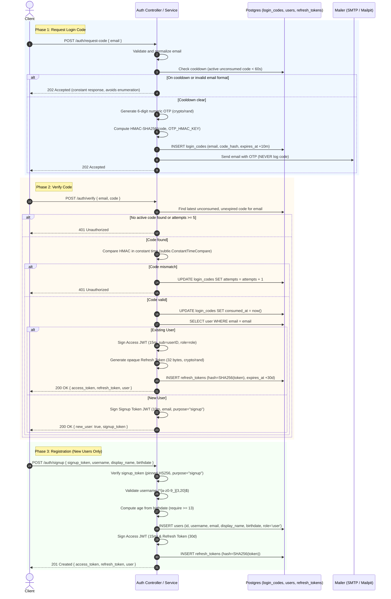
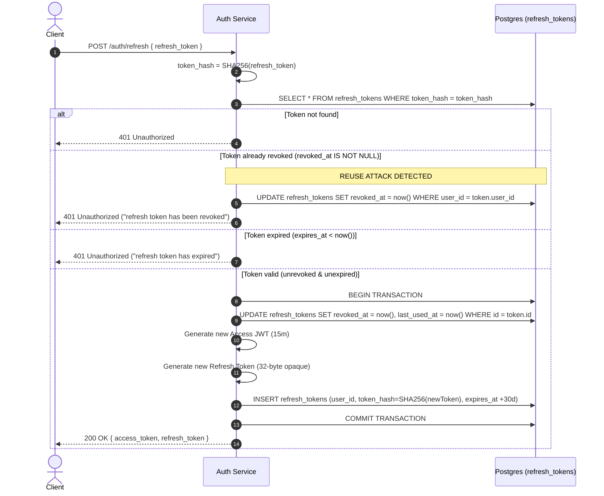
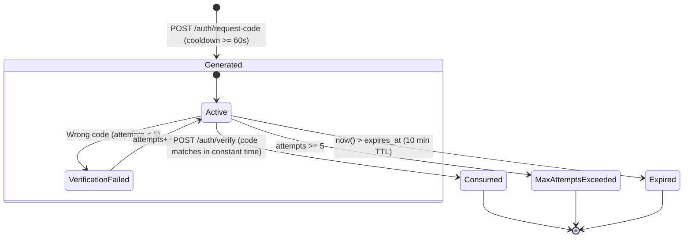
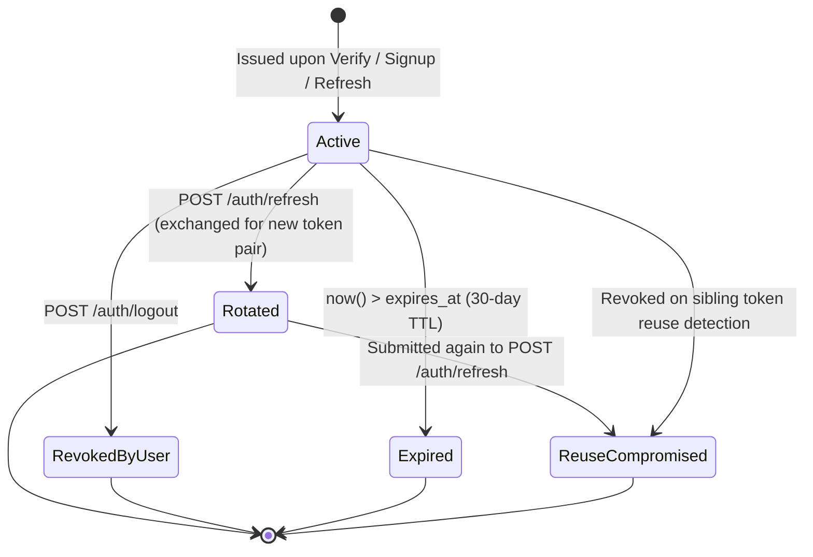

# Authentication Flow & Architecture

This document describes the passwordless authentication architecture, state transitions, security guarantees, and API endpoints for the Spill Social Media Platform backend.

---

## 1. Sequence Diagram: Complete Authentication Lifecycle

---

## 2. Sequence Diagram: Refresh Token Rotation & Reuse Attack Mitigation

Refresh tokens are single-use, 30-day opaque tokens. Every call to `POST /auth/refresh` revokes the submitted token and issues a new pair. If an already-revoked token is presented, an active reuse attack is inferred, and **all** refresh tokens for that user are revoked immediately.

---

## 3. State Diagram: OTP Code Lifecycle (`login_codes`)

---

## 4. State Diagram: Refresh Token Lifecycle (`refresh_tokens`)

---

## 5. Security Invariants & Implementation Details

1. **HMAC-SHA256 for OTP Codes**:
   - 6-digit numeric codes span only $10^6$ values. Storing plain SHA-256 digests would allow trivial offline rainbow table / precomputed lookups.
   - Spill computes `HMAC-SHA256(code, OTP_HMAC_KEY)` where `OTP_HMAC_KEY` is a minimum 32-byte server secret.
   - The resulting 64-character hex digest is verified using `crypto/subtle.ConstantTimeCompare`.

2. **Never Log Codes Rule**:
   - OTP codes and raw refresh tokens are never written to server logs, stdout, or diagnostics, even in development mode.
   - Mailer logs only recipient and subject.

3. **Enumeration Defenses**:
   - `POST /auth/request-code` always responds with `202 Accepted` regardless of whether the email is registered or on cooldown.

4. **Database-Enforced Cooldown & Brute Force Guard**:
   - Cooldown (`OTP_RESEND_COOLDOWN = 60s`): checked in PostgreSQL before inserting.
   - Brute-force limit (`attempts < 5`): enforced directly on the `login_codes` row.

5. **Algorithm Pinning**:
   - JWT verification explicitly requires `token.Method.Alg() == "HS256"`. Tokens specifying `"none"`, asymmetric keys (`RS256`), or unsupported algorithms are rejected immediately.

6. **Age Requirement**:
   - `POST /auth/signup` calculates the applicant's exact age on the server as of the current date and enforces age $\ge 13$.

7. **Mailer Environments**:
   - `MAILER=mailpit`: Delivers unauthenticated SMTP messages to `localhost:1025` for inspection at `http://localhost:8025`.
   - `MAILER=smtp`: Connects using TLS/STARTTLS credentials via standard `net/smtp`.
