# Social Platform System Design (Go + Postgres, MVC), simplified

## 1. Requirements

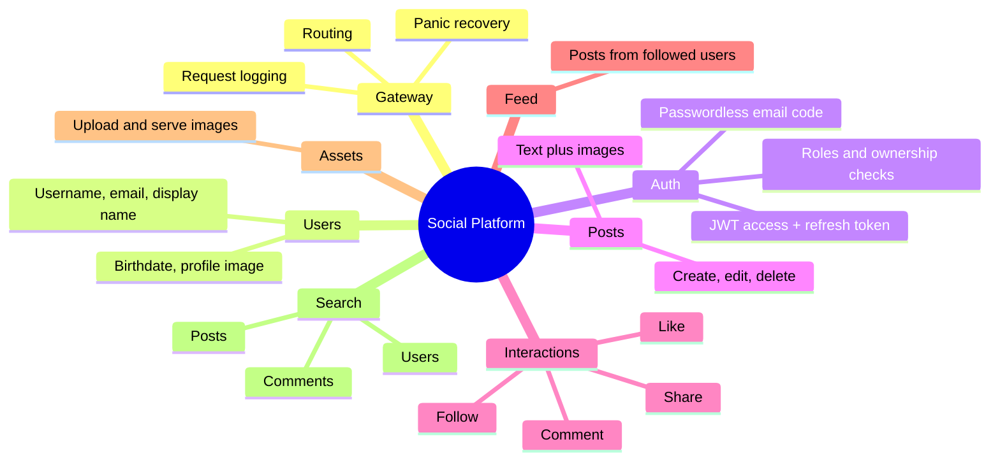

**Non-functional:** stateless app server, no password storage, and indexed queries so reads stay fast without a cache.

---

## 2. High-Level Architecture

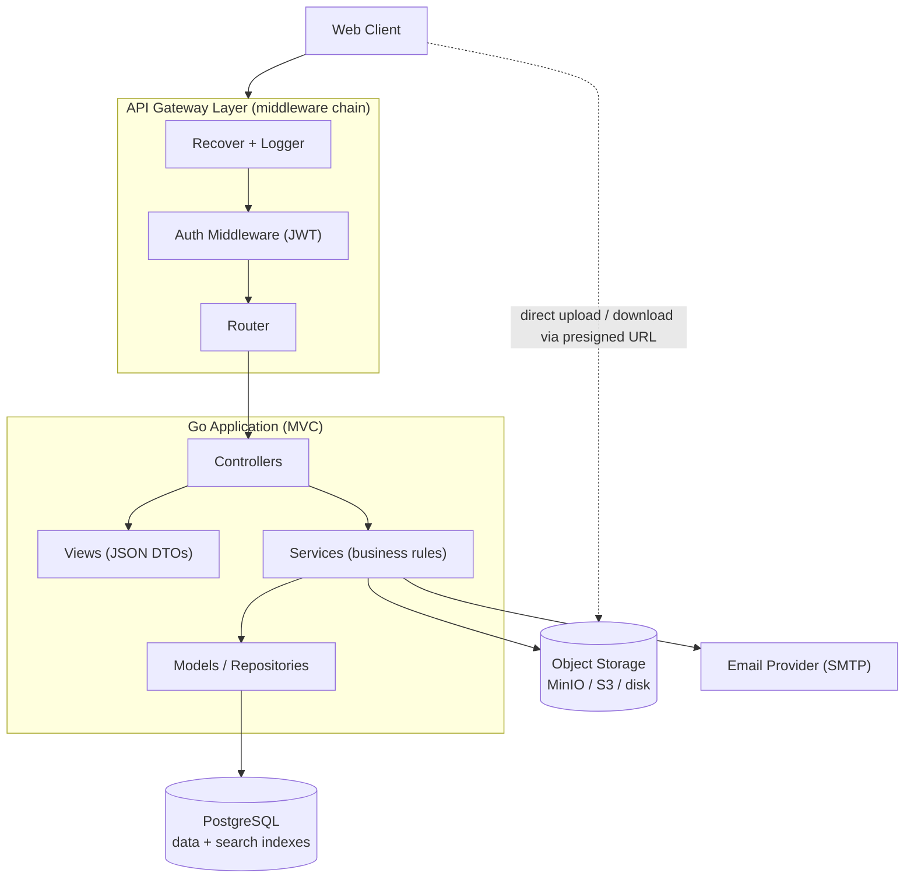

---

## 3. MVC Layout in Go

In a JSON API, the **View** is the response DTO/serializer layer.

```
/cmd/server/main.go          # wiring: config, db, router
/internal
  /config                    # env loading
  /middleware                # logger, recover, auth
  /routes                    # route table -> controllers
  /controllers               # HTTP handlers (parse, validate, call service, respond)
  /services                  # business logic (auth, posts, feed, search...)
  /models                    # structs + repository (SQL queries via pgx)
  /views                     # response DTOs / mappers
  /storage                   # object storage client (presign, head, delete)
  /mailer                    # send OTP emails
/migrations                  # golang-migrate .sql files
```

**Suggested libs:** `gorilla/mux` (router), `pgx` (Postgres), `golang-jwt/jwt`, `golang-migrate`, `go-playground/validator`.

### Request lifecycle

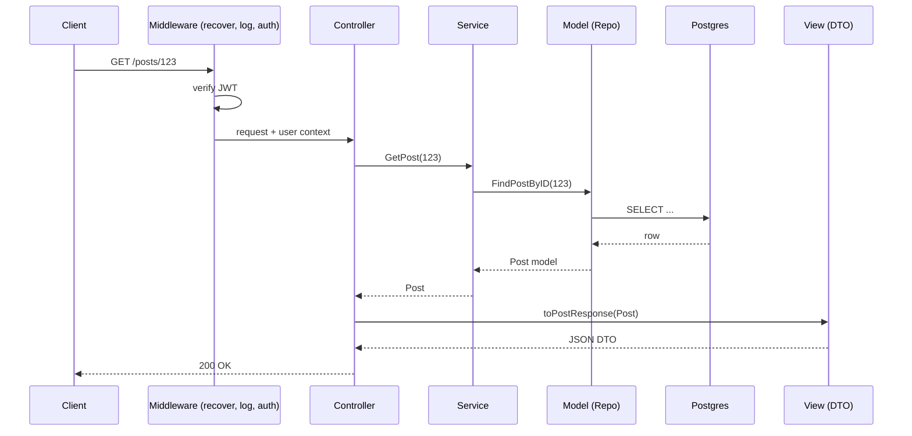

---

## 4. Component Internals

### 4.1 API Gateway

A middleware chain: **Recover → Logger → Auth → Router**.

| Middleware | Job |
|---|---|
| Recover | Catches panics and returns 500 instead of crashing |
| Logger | Logs method, path, status, latency, and a request ID |
| Auth | Parses the JWT if present and puts `userID` and `role` in the request context |
| Router | Maps routes to controllers. Protected routes are wrapped with `RequireAuth` |

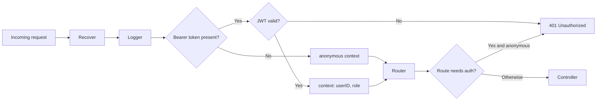

### 4.2 Authentication and Authorization

**Passwordless flow (email one-time code):**

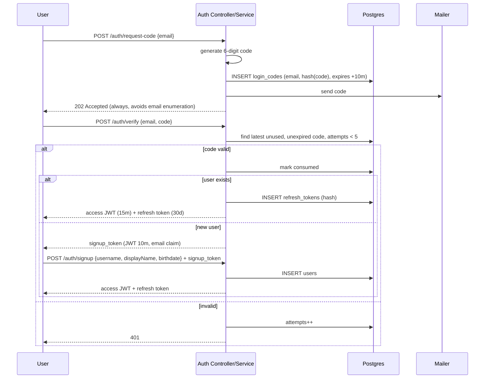

**Details**
- Store **hashes** of codes and refresh tokens (SHA-256), never raw values.
- The `attempts < 5` check on each code is simple brute-force protection that lives in the DB. It is separate from the removed rate limiter.
- Access JWT claims: `sub` (user id), `role`, `exp`. Refresh tokens are rotated on use (`POST /auth/refresh`) and revoked on logout.
- Signup validation: username `^[a-z0-9_]{3,20}$` and unique; age ≥ 13 from `birthdate`.

**Authorization (simple RBAC + ownership):**
- Roles: `user`, `admin`.
- `RequireAuth` rejects missing or invalid JWTs.
- Ownership check in the service layer: only `post.author_id == currentUser` can edit or delete (admins can delete any).

### 4.3 Users and Profiles
- Fields: `username` (unique, case-insensitive via `citext`), `email` (unique, private), `display_name`, `birthdate` (private), `avatar_asset_id`.
- The public profile response excludes email and birthdate. The View layer enforces this by using a separate `PublicUserResponse` DTO.

### 4.4 Posts

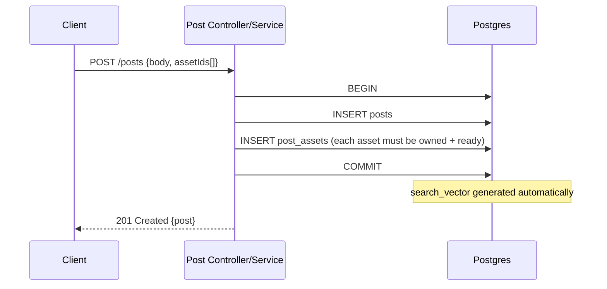

### 4.5 Relationships and Interactions

| Action | Endpoint | DB effect |
|---|---|---|
| Like / unlike | `PUT/DELETE /posts/{id}/like` | insert/delete `likes`, update `posts.like_count` (same transaction) |
| Comment | `POST /posts/{id}/comments` | insert `comments`, `comment_count++` |
| Share | `POST /posts/{id}/share` | insert `shares`, `share_count++` |
| Follow / unfollow | `PUT/DELETE /users/{id}/follow` | insert/delete `follows`, update the two counters |

Composite primary keys make likes and follows **idempotent** (`INSERT ... ON CONFLICT DO NOTHING`), and the counter only changes if a row was actually inserted.

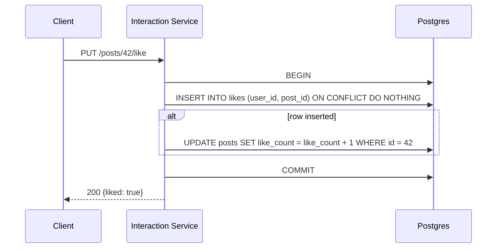

**Home feed** (fan-out on read, the simplest approach):
```sql
SELECT p.* FROM posts p
JOIN follows f ON f.followee_id = p.author_id
WHERE f.follower_id = $1
  AND p.deleted_at IS NULL
  AND (p.created_at, p.id) < ($2, $3)
ORDER BY p.created_at DESC, p.id DESC
LIMIT 20;
```
Use **keyset pagination** (cursor = `created_at, id`) with the index `posts(author_id, created_at DESC)`.

### 4.6 Assets

Use a **presigned upload** so large files never pass through the Go server.

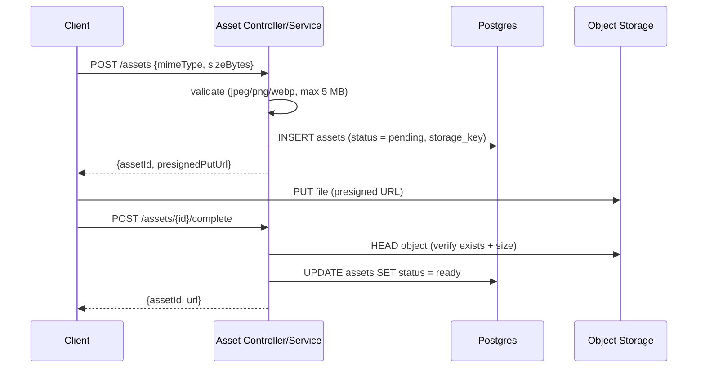

- Public read URL: `https://<storage-host>/{storage_key}`. Keys look like `u/{userId}/{uuid}.webp`.
- A small cleanup job (a goroutine with a ticker) deletes `pending` assets older than 1 hour.
- Simplest alternative for a course project: store files on local disk and serve them with `http.FileServer`.

### 4.7 Search (inverted index)

Postgres full-text search stores a **`tsvector`** (the tokens) and uses a **GIN index**, which is an inverted index mapping `token → list of rows`. You don't have to build one yourself.

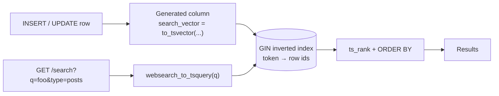

| Target | Strategy |
|---|---|
| Usernames | prefix search: `username ILIKE 'q%'` (with `text_pattern_ops` index) |
| Display names | `tsvector` with `'simple'` config (no stemming for names) + GIN |
| Posts | `tsvector` on `body` with `'english'` config + GIN |
| Comments | same as posts |

```sql
SELECT id, body, ts_rank(search_vector, q) AS rank
FROM posts, websearch_to_tsquery('english', $1) q
WHERE search_vector @@ q AND deleted_at IS NULL
ORDER BY rank DESC, created_at DESC
LIMIT 20 OFFSET $2;
```

---

## 5. Database Design

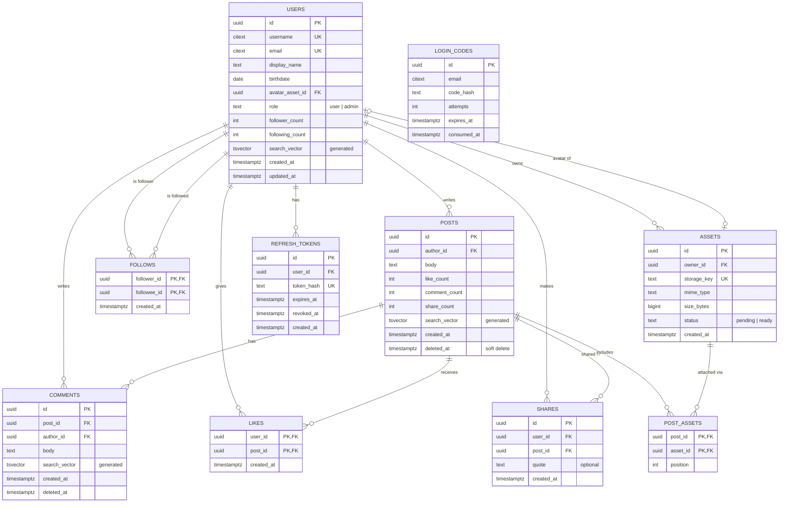

`LOGIN_CODES` is keyed by email rather than a foreign key, because a code is requested before the user may exist.

### Key indexes and constraints

```sql
CREATE EXTENSION IF NOT EXISTS citext;

-- feed + profile timelines
CREATE INDEX idx_posts_author_created ON posts (author_id, created_at DESC);
CREATE INDEX idx_comments_post_created ON comments (post_id, created_at);
CREATE INDEX idx_follows_followee ON follows (followee_id);   -- "who follows me"
CREATE INDEX idx_login_codes_email ON login_codes (email, expires_at DESC);

-- search (inverted indexes)
ALTER TABLE posts ADD COLUMN search_vector tsvector
  GENERATED ALWAYS AS (to_tsvector('english', body)) STORED;
CREATE INDEX idx_posts_search ON posts USING GIN (search_vector);
-- same pattern for comments (english) and users (to_tsvector('simple', display_name))
CREATE INDEX idx_users_username_prefix ON users (username text_pattern_ops);

-- sanity
ALTER TABLE follows ADD CONSTRAINT no_self_follow CHECK (follower_id <> followee_id);
```

---

## 6. API Surface

| Area | Endpoints |
|---|---|
| Auth | `POST /auth/request-code`, `/auth/verify`, `/auth/signup`, `/auth/refresh`, `/auth/logout` |
| Users | `GET /users/{username}`, `GET/PATCH /me`, `PUT/DELETE /users/{id}/follow`, `GET /users/{id}/followers`, `/following` |
| Posts | `POST /posts`, `GET/PATCH/DELETE /posts/{id}`, `GET /feed`, `GET /users/{id}/posts` |
| Interactions | `PUT/DELETE /posts/{id}/like`, `POST /posts/{id}/share`, `GET/POST /posts/{id}/comments`, `DELETE /comments/{id}` |
| Assets | `POST /assets`, `POST /assets/{id}/complete` |
| Search | `GET /search?q=&type=users\|posts\|comments&page=` |

---

## 7. Data Interaction Overview

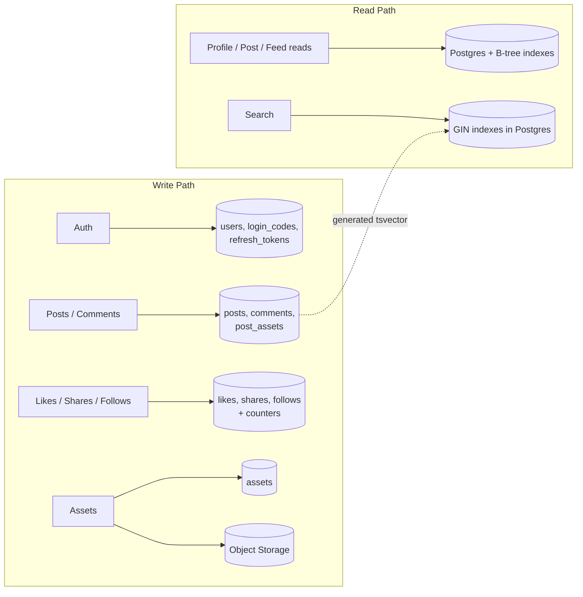
